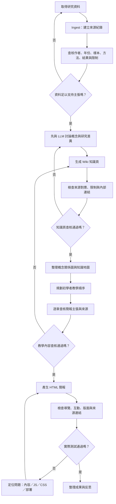

# HEART-LAB｜LLM Wiki 建置與 Loop／Graph 執行紀錄

- 專案主題：心動研究所｜從心理學看追星文化
- 核心問題：我們為什麼會對一個可能永遠不認識自己的人，產生這麼多情感？
- 紀錄用途：課程「用 LLM Wiki 做一份教學 HTML 簡報」作業說明
- 本文件依專案現有來源匯入紀錄、知識地圖、教學內容查核與 HTML 測試紀錄整理；不把尚未執行的自動化流程寫成已完成。

## 一、LLM Wiki 主題與介紹

HEART-LAB 以心理學研究為基礎，主要使用 K-pop 粉絲文化作為案例，整理喜歡偶像的心理機制、擬社會互動與關係、粉絲認同與社群歸屬、FoMO、收藏消費，以及健康追星與心理界線。

本專案不把追星直接視為不理性或心理問題，而是同時呈現追星可能帶來的快樂、支持與歸屬，也討論可能出現的焦慮、群體壓力與消費風險。內容以繁體中文和生活化例子呈現，讓沒有心理學背景的讀者也能理解。

## 二、Wiki 平台與成果位置

目前採用 **GitHub Repository 作為 Markdown 知識庫的管理與展示位置**，由 LLM 協助閱讀、討論、整理與轉寫資料。這是以 LLM 協助建立的主題知識 Wiki，不宣稱 GitHub Repository 本身是獨立的 LLM Wiki 服務。

- 專案 Repository：<https://github.com/Tina710526/HEART-LAB>
- 來源資料：`01_SOURCES/`
- Wiki 知識頁：`02_KNOWLEDGE/`
- 概念關係圖與知識地圖：`04_KNOWLEDGE_GRAPH/`
- 文獻匯入與查核紀錄：`05_QUALITY_CONTROL/`

## 三、資料 Ingest 與 Wiki 成果

目前正式來源共 **13 筆（S001–S013）**：
- 12 筆已取得可確認全文，並核對研究目的、方法、樣本、主要結果與限制。
- 1 筆（S003）已取得完整論文，但本專案只核對與 Wiki 主張直接相關的核心章節，因此獨立列出，不混入全文已核對數。
- Wiki 知識頁共 **11 頁**（後續新增「研究方法與證據判讀」，補足簡報第 12、13 頁）。

來源匯入不是只複製摘要。每筆資料依可取得版本記錄作者、年份、研究目的、研究類型、樣本或回顧範圍、方法、主要發現與限制；再將可支持的主張轉寫成白話說明，並連結相關知識頁。

### 來源到知識頁的對應例子

| 來源 | 研究主題 | 對應 Wiki 知識 |
|---|---|---|
| S001、S008 | 擬社會互動（PSI）與擬社會關係（PSR） | 擬社會互動與擬社會關係 |
| S002、S007、S009 | 粉絲認同、線上活動、社群連結 | 粉絲認同與正向心理社會結果、線上粉絲身分 |
| S004、S005、S006 | FoMO 理論、粉絲經驗與網路使用 | FoMO 心理學基礎、錯失恐懼與追星社群、FoMO 與問題性網路使用 |
| S003、S012、S013 | 小卡收藏、稀缺感、購買動機與消費 | 小卡收藏的情感與社群意義、粉絲消費心理 |
| S010 | 單純接觸效應與熟悉感 | 心動的開始：熟悉感與好感 |
| S011 | 一般名人崇拜、心理空虛與歸屬需求 | 健康追星與心理界線 |

完整清單見 `05_QUALITY_CONTROL/INGEST_REPORT.md`；來源與知識頁的完整對照見 `04_KNOWLEDGE_GRAPH/KNOWLEDGE_MAP.md`。

## 四、Loop／Graph 設計

本專案使用「資料取得 → Ingest 與來源查核 → 先討論概念 → 生成 Wiki → Wiki 交叉整理 → 教學大綱 → 內容查核 → HTML 生成 → 瀏覽器測試」的流程。前半段確保知識有來源，後半段確保教學內容能被初學者理解且實際可操作。

### 哪些步驟會重複？

1. **資料查核迴圈**：如果來源版本、樣本、方法或研究結果不清楚，就回到資料取得階段補查，不直接寫進知識頁。
2. **Wiki 修訂迴圈**：生成知識頁後，檢查主張是否有來源支持、是否保留研究限制、是否連到相關概念；不通過就回到討論與整理階段修訂。
3. **簡報內容迴圈**：逐章核對教學主張與 Wiki／來源；若內容過度延伸或把相關性寫成因果，就回到 Wiki 修正，再更新簡報。
4. **HTML 測試迴圈**：瀏覽器測試若發現問題，依問題類型修改 HTML、JavaScript、CSS 或部署設定，再重新測試。

### 哪些地方需要檢查？為什麼？

- **來源進入 Wiki 前**：先確認資料版本與研究限制，避免錯誤資訊進入後續所有內容。
- **Wiki 生成後**：檢查白話轉寫有沒有擴大原研究結論，並確認來源與概念連結。
- **簡報生成前**：檢查每章重要主張是否能追溯至 Wiki 和原始來源，讓簡報不是只靠模型自由生成。
- **HTML 完成後**：實際操作導覽、測驗、來源卡片、反思欄位及手機版，因為程式碼存在不代表功能一定正常。

## 五、一次實際執行與檢查紀錄

### Wiki 與教學內容檢查

2026-11-15 完成一輪教學內容查核，範圍包括七章教學大綱、學習目標、10 頁 Wiki 與 S001–S013 來源紀錄。查核結果為七章均有對應來源，或清楚標示為生活情境／教學整理；同時保留研究樣本與方法限制。

特別檢查粉絲消費章節：S012 的作者文字將自我控制描述為緩衝效果，但表 6 的交互作用係數為正值（β=.181），且缺少足以釐清方向的資訊，因此沒有把「自我控制已被證明會削弱衝動購買」寫成確定結論。

### HTML 開發與測試

2026-11-18 完成 18 頁 HTML 教學簡報初版，包含投影片導覽、章節選單、PSI／PSR 情境互動、研究判讀測驗、反思欄位與 S001–S013 來源清單。

開發檢查時發現快問快答原本只顯示相同回饋，沒有依照答題正確與否區分。已修改 `script.js`，讓回饋依答案顯示，並在作答後鎖定該題。

使用者於 2026-11-18 回報並提供截圖／操作確認：
- 網站可載入，第 1 頁可切換至第 2 頁，頁碼與進度同步更新。
- 章節選單可直接跳轉。
- 互動測驗可操作。
- 來源卡片可展開，來源連結可開啟。
- 反思欄位可輸入、複製與清除。
- 手機版顯示正常。

以上互動結果屬使用者實際瀏覽器測試回報，不宣稱為自動化測試。後續於 2026-11-19 完成使用者回報的 Chrome／Edge 完整 18 頁操作確認，兩者 Console 均未看到紅色錯誤。此為人工操作回報，不是自動化測試；靜態檢查與人工回報的範圍分別記錄於 `05_QUALITY_CONTROL/HTML_IMPLEMENTATION_QA.md`。

## 六、反思與 Workflow 調整

### 哪一個節點最容易出錯？

目前最容易出錯的是 **「把研究內容轉成教學說法」以及「把互動需求轉成程式回饋」** 這兩個交界。

- 研究轉寫時，容易把特定樣本的結果擴大成所有粉絲都如此，或把相關／中介結果寫成因果。
- HTML 互動實作時，按鈕看起來能點，不代表回饋邏輯正確；本次就發現快問快答沒有區分答對與答錯。

### 發現問題後，把檢查往前移到哪裡？

1. 將研究樣本、方法、結果與限制的核對放在 Wiki 生成與簡報撰寫之前，而不是等簡報完成才檢查。
2. 將「每個重要教學主張能否回到來源」放進逐章內容查核。
3. 將互動回饋邏輯納入程式開發檢查，並在完成後實際點選，而不是只確認按鈕存在。

### 有沒有修改 Workflow／Graph？為什麼？

有。流程由單純的線性「蒐集資料 → 整理 → 產生簡報」，調整為帶有回饋迴圈的流程：來源不充分就回到資料取得；Wiki 或教學主張不通過就回到知識整理；互動測試失敗就依問題類型回到程式修改，再重新測試。

這樣設計是因為前面階段的錯誤會一路影響後面的簡報。把查核提前，可以減少錯誤被複製到多個知識頁與投影片，也能讓每次修改都有明確依據。

## 七、成果連結

- GitHub Repository：<https://github.com/Tina710526/HEART-LAB>
- 教學 HTML 簡報：<https://tina710526.github.io/HEART-LAB/#slide-1>
- 文獻匯入紀錄：<https://github.com/Tina710526/HEART-LAB/blob/main/05_QUALITY_CONTROL/INGEST_REPORT.md>
- 知識地圖：<https://github.com/Tina710526/HEART-LAB/blob/main/04_KNOWLEDGE_GRAPH/KNOWLEDGE_MAP.md>
- 教學內容查核：<https://github.com/Tina710526/HEART-LAB/blob/main/05_QUALITY_CONTROL/TEACHING_CONTENT_CHECK.md>
- HTML 實作與測試紀錄：<https://github.com/Tina710526/HEART-LAB/blob/main/05_QUALITY_CONTROL/HTML_IMPLEMENTATION_QA.md>

## 八、補充的 LLM 討論與 Wiki 修訂紀錄

2026-11-19 以 S010 實際進行一輪「先討論、後修訂」：先閱讀來源與既有知識頁，討論單純接觸效應如何用追星日常解釋、熟悉感是否等於喜歡，以及研究不能支持哪些結論；再依使用者偏好加入刷到舞台、反覆看到直拍／訪談／綜藝、逐漸認得偶像並可能期待更新的生活例子。新增內容明確標示為教學情境，不是研究個案。討論、修訂及逐項查核紀錄見 [LLM 討論與生成紀錄](./LLM_DISCUSSION_AND_GENERATION_LOG.md)。

### 2026-11-19：S001、S008 的實際討論與 Wiki 修訂

接續 S010 的補充流程，先閱讀 S001、S008 來源紀錄，再討論 PSI／PSR 的差異與 K-pop 直播的教學例子。討論後才在「擬社會互動與擬社會關係」知識頁新增直播情境：直播當下彷彿被偶像關心用來說明 PSI；直播結束後仍持續熟悉、關心偶像用來說明 PSR。另補充若偶像針對特定留言作出回覆，便不能將該段互動簡化為單向擬社會現象。

查核時特別保留 S001 為一般媒體人物研究趨勢回顧、S008 為特定 K-pop 直播回歸情境的橫斷式問卷研究；保留 S008 的樣本與研究限制，並避免把變項間正向關係寫成因果。完整討論、Wiki 修訂與查核項目見 [LLM 討論與生成紀錄](./LLM_DISCUSSION_AND_GENERATION_LOG.md)。

## 九、繳交前仍需確認

- [ ] 確認老師是否接受以 GitHub Repository 管理 Markdown 知識頁作為 LLM Wiki 成果；若課堂另有指定平台，需依老師要求補上該平台的實際 Ingest／討論／生成紀錄。
- [x] 已建立實際討論、Wiki 修訂與查核文字紀錄；若老師要求特定平台畫面截圖，需另附原始截圖，不以文字紀錄冒充截圖。
- [x] 使用者確認 Chrome 與 Edge 均可操作完整 18 頁，兩者 Console 均未看到紅色錯誤。
- [x] 使用者已在 Chrome／Edge 實際開啟 GitHub Pages 並完成操作確認；仍建議繳交前由老師端再開啟一次。

